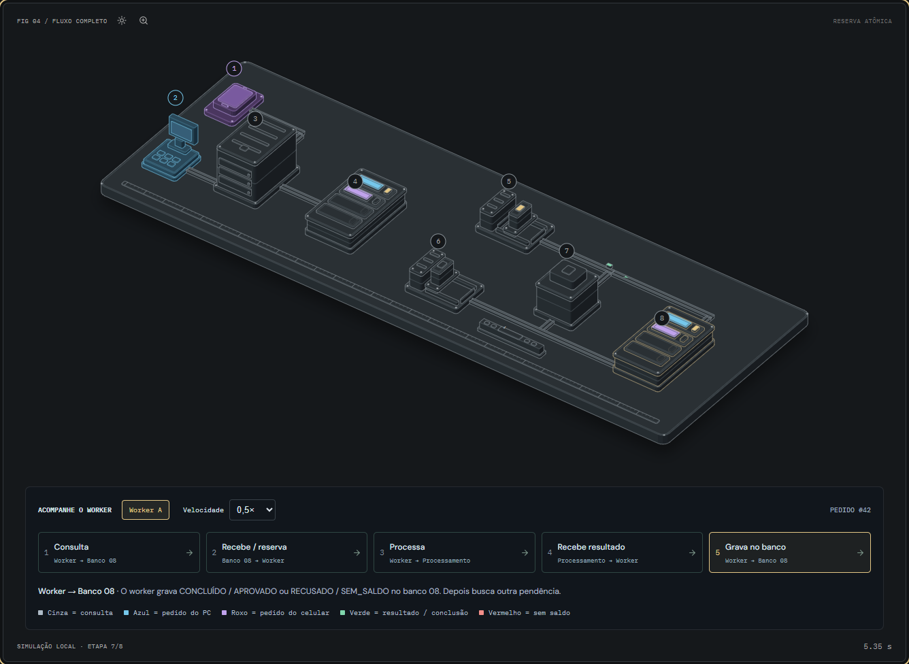
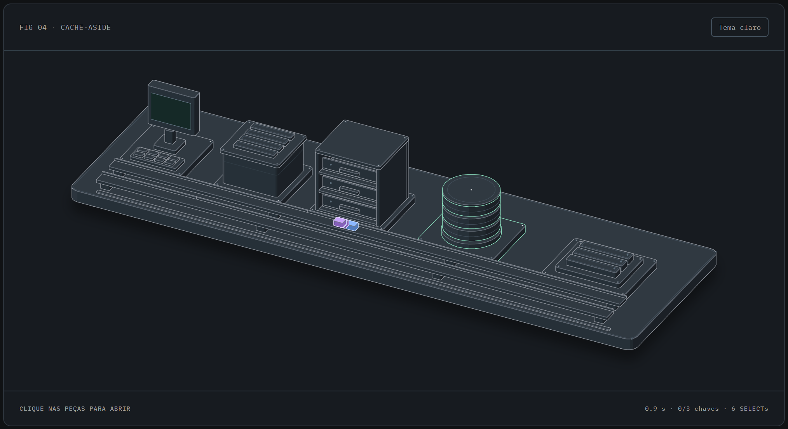
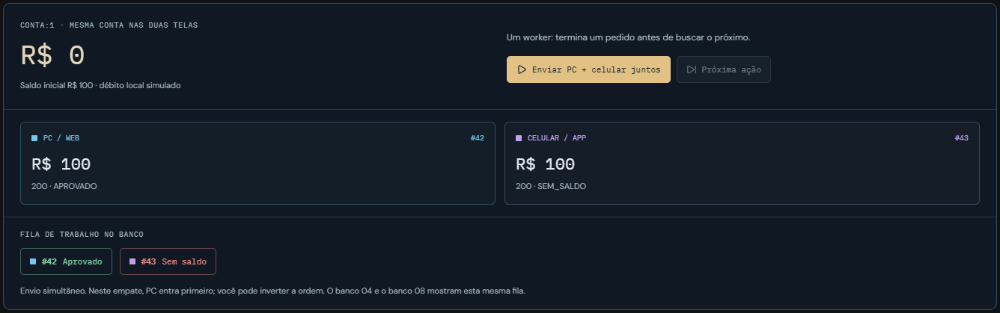

# Systems Lab

Um hub interativo para estudar backend: transformar um clique em uma requisição, escolher uma forma de comunicação, acompanhar mensagens e entender disputas por estado compartilhado.

Construído com **Next.js, TypeScript, React e SVG isométrico animado**. Os laboratórios permitem alterar parâmetros, avançar uma ação por vez e inspecionar os dados dentro de cada componente.

**[Abrir a demonstração](https://systems-lab-gabriel.vercel.app/)** · **[Experimentar concorrência](https://systems-lab-gabriel.vercel.app/labs/concurrency/)**



## O que você pode estudar

| Laboratório | Conceitos e experimentos |
| --- | --- |
| [Conexões](https://systems-lab-gabriel.vercel.app/labs/connections/) | Do evento no frontend ao JSON, HTTP, rota no backend e resposta. Compare HTTP, polling, SSE, WebSocket e webhook, com exemplos de quando usar cada um. |
| [HTTP](https://systems-lab-gabriel.vercel.app/labs/http/) | GET, POST, PUT e DELETE; corpo, headers, status, autenticação didática, latência, timeout e falhas. |
| [RabbitMQ](https://systems-lab-gabriel.vercel.app/labs/rabbitmq/) | Producer → Exchange → Queue → Consumer; roteamento por tipo, ACK, NACK, retry, dead letter queue, prefetch e múltiplos consumidores. |
| [Concorrência](https://systems-lab-gabriel.vercel.app/labs/concurrency/) | API → pendência no banco → background → processamento → resultado. Compare reserva atômica, saldo compartilhado e idempotência. |
| [Cache](https://systems-lab-gabriel.vercel.app/labs/cache/) | Cache-aside, hit/miss, TTL, invalidação, LRU, fallback, pedidos simultâneos e proteção contra preenchimento antigo. |

## Cache: uma cópia rápida, com prazo

A bancada de Cache tem sete experimentos. Compare a primeira leitura com uma leitura aquecida, altere o preço no banco e observe a cópia antiga, expire uma chave pelo relógio simulado, reduza a capacidade e desligue o cache. Com seis pedidos simultâneos, compare seis SELECTs com uma leitura compartilhada. No cenário de escrita durante a leitura, veja como uma resposta antiga pode repovoar o cache depois de um DEL e como a proteção de versão bloqueia esse preenchimento.

Clique nas peças para ver as chaves, os TTLs, as versões no banco, as chamadas da API e as respostas separadas de PC e celular. O [guia de Cache](https://systems-lab-gabriel.vercel.app/labs/cache/#guia) explica quando usar cada estratégia, seus ganhos e suas limitações. Os tempos são didáticos; a coalescência representa uma única instância de API.



## Dois pedidos, uma conta com R$ 100

PC e celular enviam ao mesmo tempo dois pedidos diferentes, cada um solicitando R$ 100 da mesma conta. O PC usa azul; o celular, roxo. Cada tela acompanha seu próprio identificador e sua própria resposta.

1. A API recebe as solicitações e grava os pedidos como `PENDENTE`.
2. Cada cliente recebe `202 Accepted`: o pedido foi recebido, ainda não aprovado.
3. Com um worker, o primeiro pedido é processado: débito de R$ 100, saldo de R$ 0.
4. O worker busca o segundo pedido e confere o saldo restante: `RECUSADO / SEM_SALDO`, sem débito.
5. Cada tela consulta a API para receber o resultado do próprio pedido.



Você pode inverter a ordem do empate, mudar o saldo e o valor solicitado, ativar dois workers e comparar as proteções:

- **Reserva atômica do pedido:** impede dois workers de pegarem a mesma pendência.
- **Conferência e débito atômicos:** impedem dois pedidos diferentes de gastarem o mesmo saldo.
- **Idempotência por pedido:** evita um novo débito ao repetir a mesma operação.

O cenário inseguro mostra dois workers lendo R$ 100 antes de debitar e gastando R$ 200. O saldo chega a −R$ 100 mesmo com pedidos reservados corretamente. No cenário protegido, um pedido é aprovado e o outro recusado. Com dois pedidos de R$ 50, ambos cabem no saldo de R$ 100.

## Interações

- Enviar PC e celular juntos e acompanhar a fila de trabalho no banco.
- Clicar nas peças, números ou nomes para ver requisições, registros, memória dos workers e extrato do processamento.
- Pausar, avançar até a próxima ação, reiniciar e reprocessar um pedido.
- Ajustar valores, origem, quantidade de workers, atraso, velocidade e proteções.
- Alternar os temas da figura e ampliar seus detalhes.
- Usar os laboratórios no celular ou pelo teclado. Na bancada de concorrência: `Espaço` executa/pausa, `Enter` avança e `R` reinicia.

## Rodar localmente

Pré-requisitos: Node.js 22 ou superior e npm.

```sh
git clone https://github.com/gabrielvilela12/systems-lab.git
cd systems-lab
npm ci
npm run dev
```

Abra [http://127.0.0.1:3000](http://127.0.0.1:3000).

Para gerar e visualizar o build de produção:

```sh
npm run build
npm start
```

A prévia fica em [http://127.0.0.1:3001](http://127.0.0.1:3001). O projeto gera uma exportação estática na pasta `out/`.

## Publicação

A demonstração está hospedada na Vercel e conectada a este repositório. Cada push na branch `main` gera uma nova publicação de produção automaticamente.

## Validação

```sh
npm run typecheck
npm test
```

A versão atual tem **65 testes** dos modelos, incluindo limites de prefetch, retries, falhas de HTTP, sessões de conexão, reserva concorrente, conservação do saldo, idempotência, TTL, invalidação, LRU, coalescência e consistência entre diferentes passos de tempo.

As auditorias das figuras verificam suporte das peças, interseções e ordem de desenho:

```sh
npm run geometry
npm run geometry:http
npm run geometry:concurrency
npm run geometry:cache
```

## Como o projeto foi organizado

```text
app/                 Páginas e estilos dos laboratórios
components/          Interfaces, figuras e painéis de inspeção
components/iso/      Kit de geometria e auditoria isométrica
lib/                 Modelos determinísticos, testes e geometria
scripts/             Auditorias, exportação de documentação e prévia
public/              Guia de conexões para download
docs/                Imagens e notas técnicas
```

Os modelos TypeScript são independentes do React. A animação, os registros e os contadores vêm do mesmo estado. A arte estática é renderizada no servidor; o controlador atualiza os movimentos sem renderizar toda a interface a cada frame.

Veja [as notas técnicas](docs/technical-notes.md) para os detalhes de cada modelo e suas referências.

## Escopo didático

Os laboratórios são **simulações locais no navegador**. Não executam um broker RabbitMQ, banco de dados, API de pagamentos ou transações financeiras reais. A exportação pode ser aberta sem credenciais ou infraestrutura externa.

Na concorrência, a tabela de pendências funciona como fila de trabalho. As peças 04 e 08 representam o **mesmo banco**, repetido no desenho para as chamadas seguirem à direita; as respostas retornam pelo caminho. A ordem em empates é determinística para facilitar o estudo.

No RabbitMQ, os limites de retry e a política de redrive pertencem à aplicação simulada. Replicação, persistência, publisher confirms e todos os tipos de exchange não estão cobertos.

## Próximos estudos

O hub apresenta como módulos planejados: bancos e transações, segurança e sistemas distribuídos. Esses módulos ainda não estão implementados.

## Créditos

O projeto foi desenvolvido com apoio do Codex e da skill Anatomy para as figuras isométricas. O kit em `components/iso/` usa a licença MIT, preservada em [components/iso/LICENSE](components/iso/LICENSE).

RabbitMQ é uma marca de seu respectivo proprietário. Este é um projeto educacional independente.
